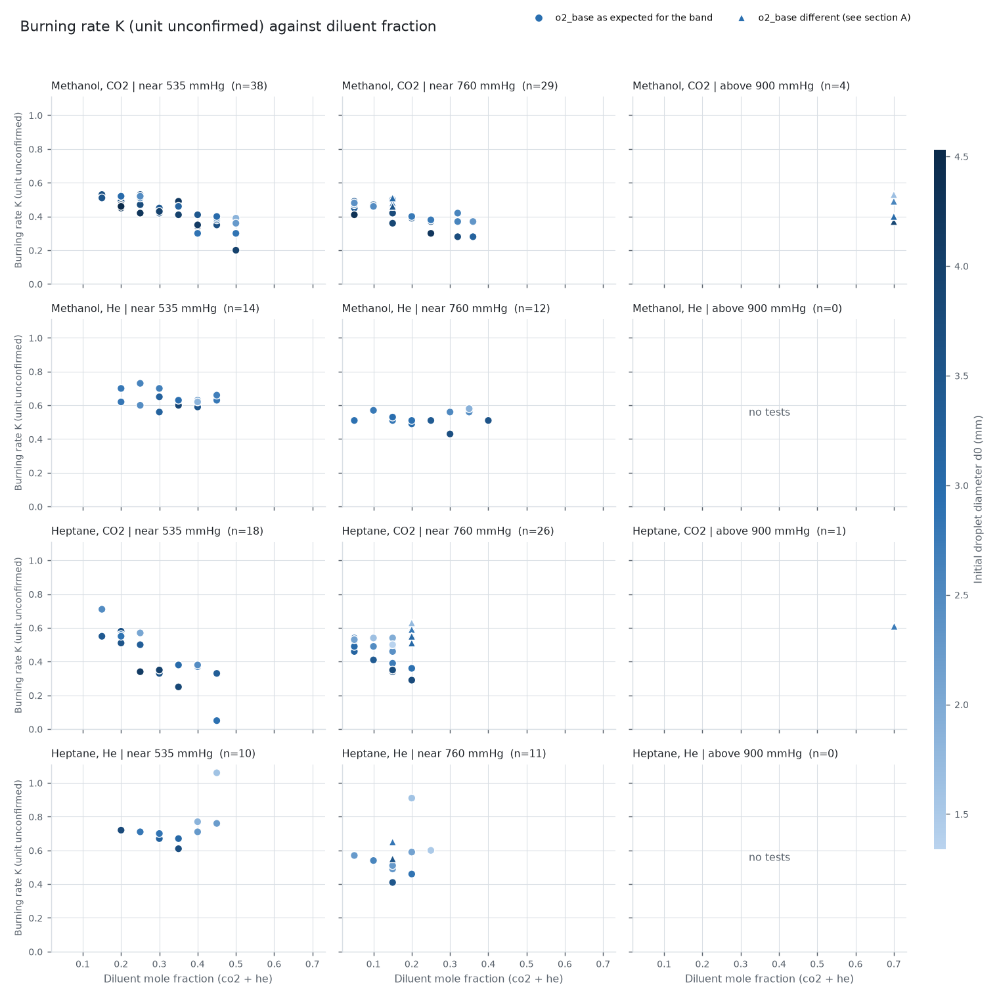
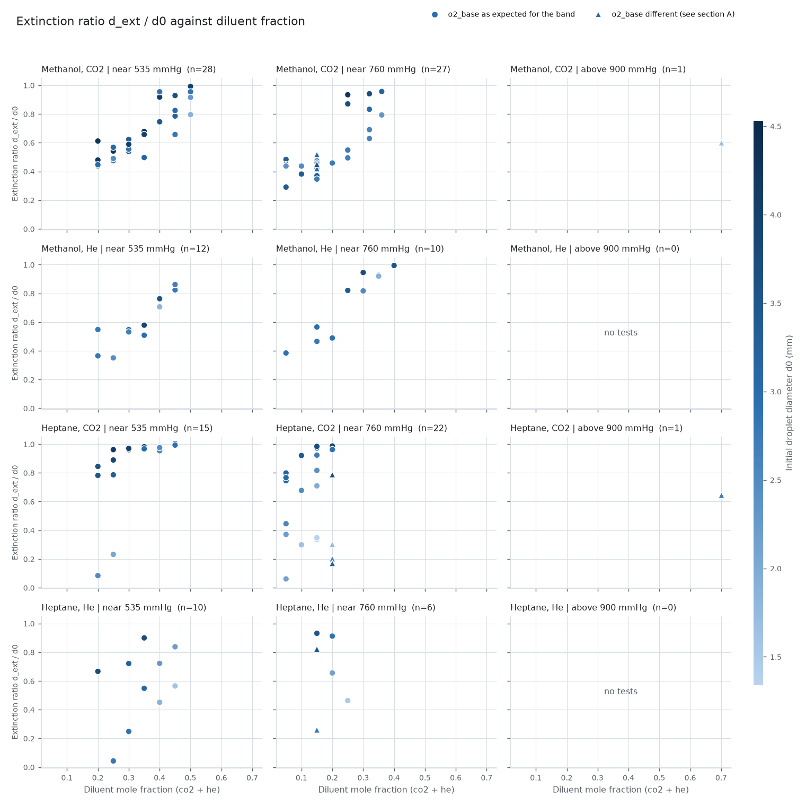
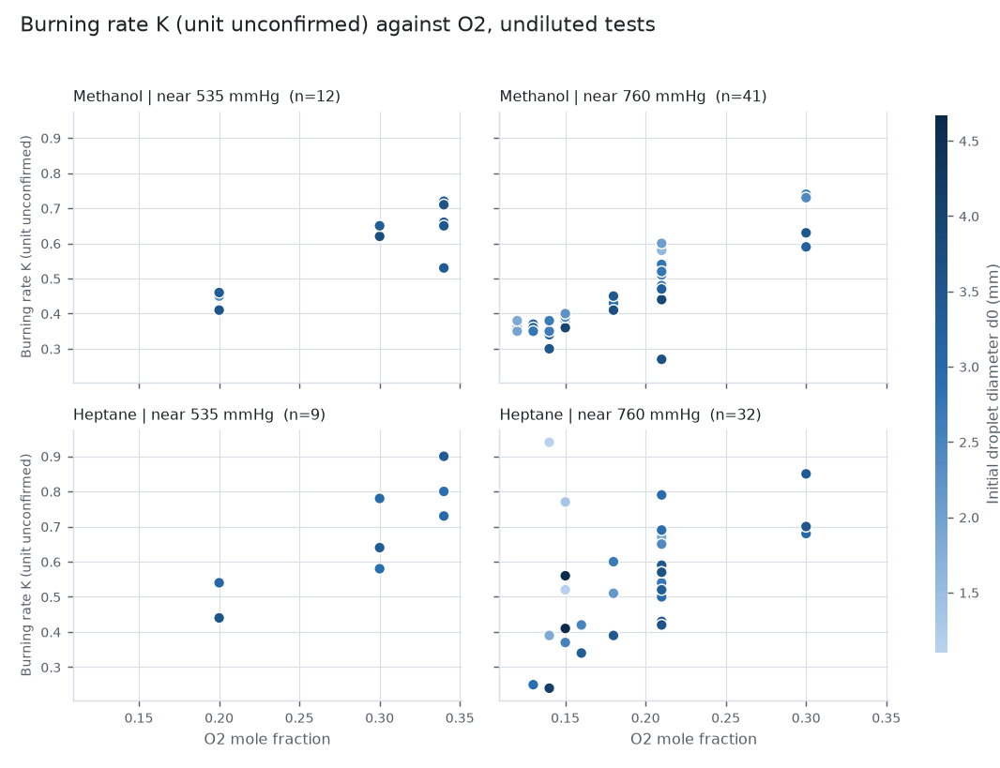
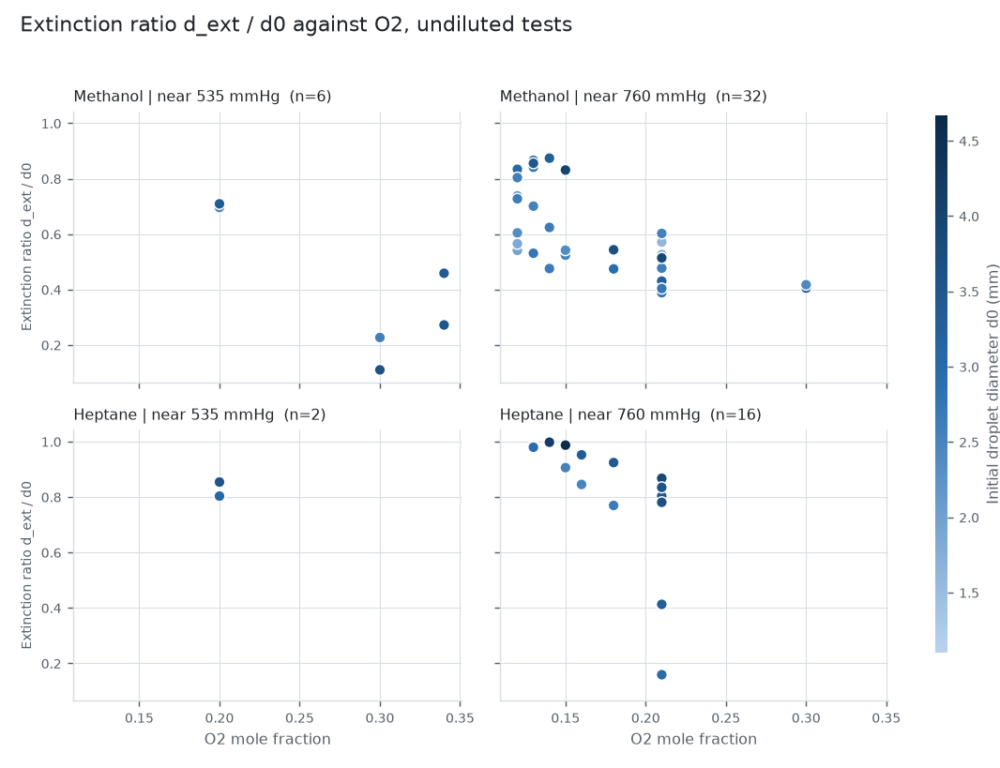

# Exploration of the cleaned FLEX data

Generated by `src/eda.py` from `data/clean/flex_clean.csv` (274 tests). Gas names O2, N2, CO2 and the unit of the burning rate are still unconfirmed.

## A. Do diluted tests cluster at a fixed o2_base?

`o2_base = o2 / (o2 + n2)` and `diluent_frac = co2 + he`. A diluted test "fits" when its o2_base is within 0.015 of the expected value (0.30 near 535 mmHg, 0.21 near 760 mmHg). The tolerance covers rounding: the raw fractions have two decimals.

| Pressure band | Diluted tests | Fit | Do not fit | o2_base range of those that fit |
|---|---|---|---|---|
| near 535 mmHg (expected 0.3) | 81 | 81 | 0 | 0.291-0.312 |
| near 760 mmHg (expected 0.21) | 82 | 68 | 14 | 0.210-0.221 |
| above 900 mmHg (expected none stated) | 9 | 0 | 9 |  |

**Near 535 mmHg: true.** All 81 diluted tests have o2_base between 0.291 and 0.312.

**Near 760 mmHg: true for 68 of 82 diluted tests**, which sit between 0.210 and 0.221. 14 tests do not fit.

**Above 900 mmHg: the hypothesis does not cover this band.** All 9 tests there are diluted and follow a different design.

Tests that do not fit:

| Pressure band | Diluent | O2 | N2 | diluent_frac | o2_base | Fuel | Tests | Test numbers |
|---|---|---|---|---|---|---|---|---|
| above 900 mmHg | CO2 | 0.21 | 0.09 | 0.70 | 0.700 | Methanol | 7 | 10, 11, 13, 14, 15, 16, 17 |
| above 900 mmHg | CO2 | 0.21 | 0.09 | 0.70 | 0.700 | Heptane | 2 | 12, 18 |
| near 760 mmHg | CO2 | 0.24 | 0.56 | 0.20 | 0.300 | Heptane | 9 | 131, 132, 133, 134, 135, 136, 137, 138, 139 |
| near 760 mmHg | CO2 | 0.21 | 0.64 | 0.15 | 0.247 | Methanol | 3 | 168, 169, 170 |
| near 760 mmHg | He | 0.21 | 0.64 | 0.15 | 0.247 | Heptane | 2 | 273, 274 |

That is 23 tests in total: 14 near 760 mmHg and 9 above 900 mmHg.

Test 114 (pressure printed as 0, so no band) has CO2 0.35 and o2_base 0.308, like the 535 mmHg group, but its band is not assigned.

Full table, including undiluted tests:

| Pressure band | Diluent | o2_base (rounded) | Tests | o2_base range | diluent_frac range | O2 range |
|---|---|---|---|---|---|---|
| near_535 | CO2 | 0.29 | 10 | 0.291-0.294 | 0.15-0.20 | 0.23-0.25 |
| near_535 | CO2 | 0.30 | 23 | 0.300 | 0.20-0.50 | 0.15-0.24 |
| near_535 | CO2 | 0.31 | 24 | 0.307-0.312 | 0.25-0.45 | 0.17-0.23 |
| near_535 | He | 0.30 | 13 | 0.300 | 0.20-0.40 | 0.18-0.24 |
| near_535 | He | 0.31 | 11 | 0.307-0.309 | 0.25-0.45 | 0.17-0.23 |
| near_535 | none | 0.20 | 5 | 0.200-0.202 | 0.00 | 0.20 |
| near_535 | none | 0.30 | 8 | 0.300 | 0.00 | 0.30 |
| near_535 | none | 0.34 | 9 | 0.340 | 0.00 | 0.34 |
| near_760 | CO2 | 0.21 | 38 | 0.210-0.213 | 0.05-0.25 | 0.16-0.20 |
| near_760 | CO2 | 0.22 | 6 | 0.217-0.221 | 0.32-0.36 | 0.14-0.15 |
| near_760 | CO2 | 0.25 | 3 | 0.247 | 0.15 | 0.21 |
| near_760 | CO2 | 0.30 | 9 | 0.300 | 0.20 | 0.24 |
| near_760 | He | 0.21 | 21 | 0.210-0.214 | 0.05-0.30 | 0.15-0.20 |
| near_760 | He | 0.22 | 3 | 0.215-0.217 | 0.35-0.40 | 0.13-0.14 |
| near_760 | He | 0.25 | 2 | 0.247 | 0.15 | 0.21 |
| near_760 | none | 0.12 | 8 | 0.120-0.121 | 0.00 | 0.12 |
| near_760 | none | 0.13 | 8 | 0.130-0.133 | 0.00 | 0.13 |
| near_760 | none | 0.14 | 7 | 0.140-0.143 | 0.00 | 0.14 |
| near_760 | none | 0.15 | 10 | 0.150-0.151 | 0.00 | 0.15 |
| near_760 | none | 0.16 | 3 | 0.160 | 0.00 | 0.16 |
| near_760 | none | 0.18 | 7 | 0.180-0.182 | 0.00 | 0.18 |
| near_760 | none | 0.21 | 29 | 0.210 | 0.00 | 0.21 |
| near_760 | none | 0.30 | 7 | 0.300 | 0.00 | 0.30 |
| above_900 | CO2 | 0.70 | 9 | 0.700 | 0.70 | 0.21 |

What this means for modelling: among the diluted tests that fit, O2 is almost fixed by the diluent fraction (`o2 = o2_base x (1 - diluent_frac)`). Correlation between `o2_mole_frac` and `diluent_frac` in those tests: near 535 mmHg -0.992; near 760 mmHg -0.999. Within a band the data cannot separate "less oxygen" from "more diluent"; only the comparison between CO2 and He, and against the undiluted tests, can.

## B. Targets against diluent fraction

One panel per fuel, diluent and pressure band. Colour is the initial droplet diameter. Triangles are the tests that do not fit the o2_base pattern of section A. Tests without the target or without d0 are not drawn, and neither is test 114.

Rank correlation (Spearman) between each target and diluent_frac, per panel, using only tests that fit the o2_base pattern. Blank when fewer than 5 tests.

| Fuel | Diluent | Pressure band | Tests with K | rho K | Tests with ratio | rho ratio | rho d0 vs diluent_frac |
|---|---|---|---|---|---|---|---|
| Methanol | CO2 | near 535 mmHg | 38 | -0.85 | 28 | +0.86 | -0.29 |
| Methanol | CO2 | near 760 mmHg | 26 | -0.78 | 24 | +0.77 | -0.11 |
| Methanol | He | near 535 mmHg | 14 | -0.15 | 12 | +0.86 | +0.04 |
| Methanol | He | near 760 mmHg | 12 | +0.10 | 10 | +0.91 | -0.02 |
| Heptane | CO2 | near 535 mmHg | 18 | -0.82 | 15 | +0.85 | -0.01 |
| Heptane | CO2 | near 760 mmHg | 18 | -0.61 | 18 | +0.52 | +0.08 |
| Heptane | He | near 535 mmHg | 10 | +0.46 | 10 | +0.36 | -0.77 |
| Heptane | He | near 760 mmHg | 9 | +0.36 | 4 |  | -0.47 |

## B. Targets against O2 for undiluted tests

O2/N2 only (101 tests). There are no undiluted tests above 900 mmHg.

| Fuel | Pressure band | Tests with K | rho K vs O2 | Tests with ratio | rho ratio vs O2 |
|---|---|---|---|---|---|
| Methanol | near 535 mmHg | 12 | +0.78 | 6 | -0.48 |
| Methanol | near 760 mmHg | 41 | +0.82 | 32 | -0.70 |
| Heptane | near 535 mmHg | 9 | +0.88 | 2 |  |
| Heptane | near 760 mmHg | 32 | +0.49 | 16 | -0.83 |

## Coverage: tests per fuel, pressure band and diluent

"Usable" means the target and d0 are both present (and, for the ratio, the extinction diameter is not printed as 0). Test 114 has no pressure band and is not in this table.

| Fuel | Pressure band | Diluent | Tests | Usable for K | Usable for ratio | O2 range | diluent_frac range | d0 range (mm) |
|---|---|---|---|---|---|---|---|---|
| Methanol | near 535 mmHg | none | 12 | 12 | 6 | 0.20-0.34 |  | 2.40-3.77 |
| Methanol | near 535 mmHg | CO2 | 38 | 38 | 28 | 0.15-0.25 | 0.15-0.50 | 1.86-4.53 |
| Methanol | near 535 mmHg | He | 14 | 14 | 12 | 0.17-0.24 | 0.20-0.45 | 1.84-3.87 |
| Methanol | near 760 mmHg | none | 42 | 41 | 32 | 0.12-0.30 |  | 1.61-3.97 |
| Methanol | near 760 mmHg | CO2 | 29 | 29 | 27 | 0.14-0.21 | 0.05-0.36 | 1.76-4.35 |
| Methanol | near 760 mmHg | He | 14 | 12 | 10 | 0.13-0.20 | 0.05-0.40 | 1.88-3.67 |
| Methanol | above 900 mmHg | none | 0 | 0 | 0 |  |  |  |
| Methanol | above 900 mmHg | CO2 | 7 | 4 | 1 | 0.21 | 0.70 | 1.66-4.42 |
| Methanol | above 900 mmHg | He | 0 | 0 | 0 |  |  |  |
| Heptane | near 535 mmHg | none | 10 | 9 | 2 | 0.20-0.34 |  | 2.91-3.87 |
| Heptane | near 535 mmHg | CO2 | 19 | 18 | 15 | 0.17-0.25 | 0.15-0.45 | 2.07-4.14 |
| Heptane | near 535 mmHg | He | 10 | 10 | 10 | 0.17-0.24 | 0.20-0.45 | 1.61-3.78 |
| Heptane | near 760 mmHg | none | 37 | 32 | 16 | 0.13-0.30 |  | 1.10-4.67 |
| Heptane | near 760 mmHg | CO2 | 27 | 26 | 22 | 0.17-0.24 | 0.05-0.20 | 1.34-3.76 |
| Heptane | near 760 mmHg | He | 12 | 11 | 6 | 0.16-0.21 | 0.05-0.25 | 1.49-3.54 |
| Heptane | above 900 mmHg | none | 0 | 0 | 0 |  |  |  |
| Heptane | above 900 mmHg | CO2 | 2 | 1 | 1 | 0.21 | 0.70 | 2.74 |
| Heptane | above 900 mmHg | He | 0 | 0 | 0 |  |  |  |
| **Total** | | | **273** | **257** | **188** | | | |

Empty cells of the atmosphere space (0 tests): Methanol, above 900 mmHg, none; Methanol, above 900 mmHg, He; Heptane, above 900 mmHg, none; Heptane, above 900 mmHg, He. CO2 and He are never mixed.

## Moon Base slice

Tests at 500-560 mmHg with o2_base >= 0.29: **98 tests** (pressure 526.3-542.8 mmHg, o2_base 0.291-0.340). Of all 103 tests near 535 mmHg, 5 are outside the slice (undiluted at O2 0.20). Test 114 is not in the slice because its pressure is printed as 0.

Note: o2_base >= 0.29 is the oxygen share before dilution. Only the undiluted tests in the slice actually have O2 >= 0.29 in the chamber (17 tests); in the diluted ones the O2 mole fraction is 0.15-0.25.

| Fuel | Diluent | Tests | O2 range | diluent_frac range | d0 range (mm) | Usable for K | K range | Usable for ratio | Ratio range | Extinction / Disruption / Completion |
|---|---|---|---|---|---|---|---|---|---|---|
| Methanol | none | 9 | 0.30-0.34 |  | 2.60-3.77 | 9 | 0.53-0.72 | 4 | 0.11-0.46 | 0 / 7 / 2 |
| Methanol | CO2 | 38 | 0.15-0.25 | 0.15-0.50 | 1.86-4.53 | 38 | 0.20-0.53 | 28 | 0.44-0.99 | 27 / 7 / 4 |
| Methanol | He | 14 | 0.17-0.24 | 0.20-0.45 | 1.84-3.87 | 14 | 0.56-0.73 | 12 | 0.35-0.86 | 12 / 2 / 0 |
| Heptane | none | 8 | 0.30-0.34 |  | 2.91-3.87 | 7 | 0.58-0.90 | 0 |  | 0 / 8 / 0 |
| Heptane | CO2 | 19 | 0.17-0.25 | 0.15-0.45 | 2.07-4.14 | 18 | 0.05-0.71 | 15 | 0.08-1.00 | 13 / 6 / 0 |
| Heptane | He | 10 | 0.17-0.24 | 0.20-0.45 | 1.61-3.78 | 10 | 0.61-1.06 | 10 | 0.04-0.90 | 8 / 0 / 2 |

Slice by diluent fraction (both fuels):

| Diluent | diluent_frac | O2 | Tests | Median K | Median ratio | Extinction / Disruption / Completion | Test numbers |
|---|---|---|---|---|---|---|---|
| CO2 | 0.15 | 0.25 | 6 | 0.53 |  | 0 / 6 / 0 | 88, 89, 90, 91, 92, 93 |
| CO2 | 0.20 | 0.23-0.24 | 11 | 0.52 | 0.48 | 5 / 5 / 1 | 94, 95, 96, 97, 104, 105, 107, 174, 175, 176, 177 |
| CO2 | 0.25 | 0.23 | 12 | 0.51 | 0.54 | 9 / 2 / 1 | 98, 99, 100, 101, 106, 108, 178, 179, 183, 184, 185, 186 |
| CO2 | 0.30 | 0.21 | 6 | 0.42 | 0.61 | 4 / 0 / 2 | 102, 103, 109, 110, 111, 112 |
| CO2 | 0.35 | 0.20 | 5 | 0.41 | 0.68 | 5 / 0 / 0 | 113, 115, 116, 117, 118 |
| CO2 | 0.40 | 0.18 | 6 | 0.36 | 0.94 | 6 / 0 / 0 | 119, 120, 121, 122, 123, 124 |
| CO2 | 0.45 | 0.17 | 7 | 0.38 | 0.88 | 7 / 0 / 0 | 125, 126, 127, 128, 129, 130, 147 |
| CO2 | 0.50 | 0.15 | 4 | 0.33 | 0.94 | 4 / 0 / 0 | 140, 141, 142, 143 |
| He | 0.20 | 0.24 | 3 | 0.70 | 0.55 | 2 / 1 / 0 | 249, 251, 252 |
| He | 0.25 | 0.23 | 3 | 0.71 | 0.20 | 1 / 1 / 1 | 250, 253, 254 |
| He | 0.30 | 0.21 | 5 | 0.67 | 0.54 | 5 / 0 / 0 | 255, 256, 257, 258, 259 |
| He | 0.35 | 0.20 | 4 | 0.62 | 0.56 | 4 / 0 / 0 | 260, 261, 262, 263 |
| He | 0.40 | 0.18 | 5 | 0.63 | 0.71 | 5 / 0 / 0 | 264, 265, 266, 267, 268 |
| He | 0.45 | 0.17 | 4 | 0.71 | 0.83 | 3 / 0 / 1 | 269, 270, 271, 272 |
| none | 0.00 | 0.30-0.34 | 17 | 0.65 | 0.25 | 0 / 15 / 2 | 19, 20, 21, 22, 23, 24, 25, 26, 27, 28, 37, 38, 39, 40, 41, 42, 43 |

Medians mix droplet sizes and both fuels, and each row has few tests. They describe the slice; they are not a model.
